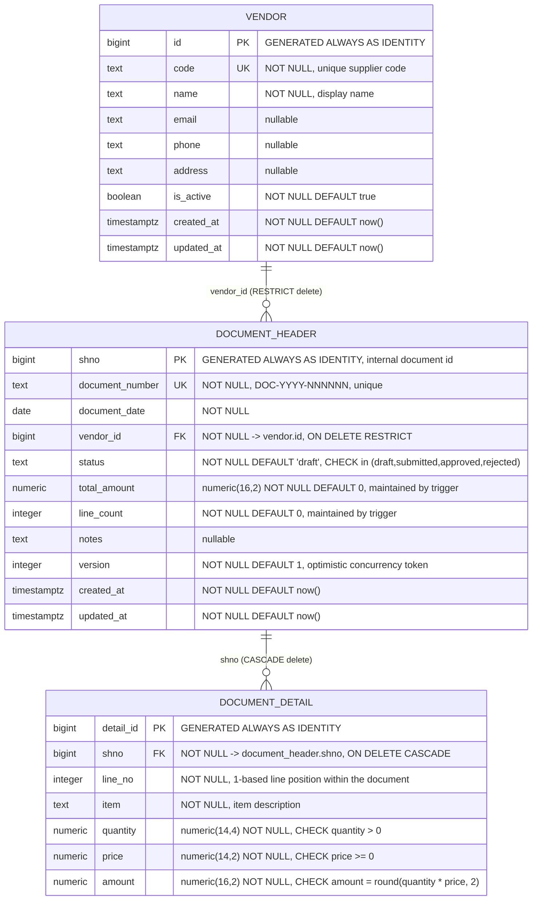

# DocFlow database schema

Generated from the live database (`docflow` schema, PostgreSQL 16) and the three
applied migrations in `prisma/migrations/`. Nothing here is inferred: column
types, constraint names and trigger definitions were read back from
`information_schema` / `pg_catalog`.

- **Schema:** `docflow` (Prisma `@@schema("docflow")`, keeps the module isolated from later Docentra modules)
- **Tables:** 3 — `vendor`, `document_header`, `document_detail`
- **Relationships:** 2 one-to-many (`vendor → document_header → document_detail`)
- **Prisma models:** `Vendor`, `DocumentHeader`, `DocumentDetail` (`prisma/schema.prisma`)

`public._prisma_migrations` also exists, but it is Prisma's own bookkeeping table,
not part of the DocFlow domain, so it is excluded from the diagram.

## ER diagram

A vendor has zero or many documents; a document belongs to exactly one vendor.
A document has zero or many lines (a draft may have none yet); a line belongs to
exactly one document via `shno`. `document_number` is the human-facing identity;
`shno` is the internal key that everything joins on.

## Tables

### `docflow.vendor`

| Column | Type | Null | Default | Notes |
|---|---|---|---|---|
| `id` | `bigint` | no | identity | Primary key |
| `code` | `text` | no | — | Unique supplier code |
| `name` | `text` | no | — | |
| `email` | `text` | yes | — | |
| `phone` | `text` | yes | — | |
| `address` | `text` | yes | — | |
| `is_active` | `boolean` | no | `true` | Soft retirement flag |
| `created_at` | `timestamptz` | no | `now()` | |
| `updated_at` | `timestamptz` | no | `now()` | Set by application writes |

### `docflow.document_header`

| Column | Type | Null | Default | Notes |
|---|---|---|---|---|
| `shno` | `bigint` | no | identity | Primary key, internal document id |
| `document_number` | `text` | no | — | Unique, `DOC-<year>-<6 digits>` |
| `document_date` | `date` | no | — | Business date, not a timestamp |
| `vendor_id` | `bigint` | no | — | FK → `vendor.id` |
| `status` | `text` | no | `'draft'` | Constrained to four workflow states |
| `total_amount` | `numeric(16,2)` | no | `0` | Derived; trigger-maintained |
| `line_count` | `integer` | no | `0` | Derived; trigger-maintained |
| `notes` | `text` | yes | — | |
| `version` | `integer` | no | `1` | Optimistic concurrency token |
| `created_at` | `timestamptz` | no | `now()` | |
| `updated_at` | `timestamptz` | no | `now()` | Also refreshed by the totals trigger |

### `docflow.document_detail`

| Column | Type | Null | Default | Notes |
|---|---|---|---|---|
| `detail_id` | `bigint` | no | identity | Primary key |
| `shno` | `bigint` | no | — | FK → `document_header.shno` |
| `line_no` | `integer` | no | — | Unique per document |
| `item` | `text` | no | — | |
| `quantity` | `numeric(14,4)` | no | — | Must be > 0 |
| `price` | `numeric(14,2)` | no | — | Must be >= 0 |
| `amount` | `numeric(16,2)` | no | — | Must equal `round(quantity * price, 2)` |

## Constraints

| Table | Name | Type | Definition |
|---|---|---|---|
| `vendor` | `vendor_pkey` | PK | `PRIMARY KEY (id)` |
| `vendor` | `vendor_code_key` | UNIQUE | `UNIQUE (code)` |
| `document_header` | `document_header_pkey` | PK | `PRIMARY KEY (shno)` |
| `document_header` | `document_header_document_number_key` | UNIQUE | `UNIQUE (document_number)` |
| `document_header` | `document_header_vendor_id_fkey` | FK | `FOREIGN KEY (vendor_id) REFERENCES vendor(id) ON DELETE RESTRICT` |
| `document_header` | `document_header_status_check` | CHECK | `status = ANY (ARRAY['draft','submitted','approved','rejected'])` |
| `document_detail` | `document_detail_pkey` | PK | `PRIMARY KEY (detail_id)` |
| `document_detail` | `document_detail_shno_fkey` | FK | `FOREIGN KEY (shno) REFERENCES document_header(shno) ON DELETE CASCADE` |
| `document_detail` | `uq_detail_line` | UNIQUE | `UNIQUE (shno, line_no)` |
| `document_detail` | `document_detail_quantity_check` | CHECK | `quantity > 0` |
| `document_detail` | `document_detail_price_check` | CHECK | `price >= 0` |
| `document_detail` | `ck_detail_amount` | CHECK | `amount = round(quantity * price, 2)` |

`ON DELETE RESTRICT` on `vendor_id` means a vendor with documents cannot be
deleted, which is why vendors are retired with `is_active = false` instead.
`ON DELETE CASCADE` on `shno` means deleting a document removes its lines.

## Triggers and functions

| Object | Kind | Behaviour |
|---|---|---|
| `trg_document_detail_totals` | AFTER INSERT/UPDATE/DELETE on `document_detail` | Recomputes the parent header's `total_amount`, `line_count` and `updated_at`, so application code, seeds and imports cannot drift apart |
| `docflow.document_detail_totals()` | trigger function | Calls `recalc_header_totals` for the affected `shno`; a moved line fixes both the old and new header |
| `docflow.recalc_header_totals(bigint)` | function | `sum(amount)` / `count(*)` for one header, coalescing `NULL` to `0` |
| `document_header_immutable` | BEFORE UPDATE on `document_header` | Rejects changes to `vendor_id`, `document_date`, `document_number`, `notes`, or any `status` change, once the row is `approved` (SQLSTATE `23514`) |
| `document_detail_immutable` | BEFORE INSERT/UPDATE/DELETE on `document_detail` | Rejects inserting or updating a line into an approved document, and deleting a line that belongs to one |
| `docflow.guard_approved_document()` | trigger function | Implements both guards; honours the transaction-local `docflow.maintenance = 'on'` override used only by the demo seeder |

Immutability is enforced in the database, not only in the application: the app
check is the friendly path, the trigger is the guarantee.

## Indexes

| Table | Index | Definition | Purpose |
|---|---|---|---|
| `document_header` | `document_header_pkey` | `(shno)` unique | PK |
| `document_header` | `document_header_document_number_key` | `(document_number)` unique | Lookup by business number |
| `document_header` | `ix_header_vendor_date` | `(vendor_id, document_date)` | Vendor-filtered listings |
| `document_header` | `ix_header_status` | `(status)` | Status filters and dashboard counts |
| `document_header` | `document_header_date_idx` | `(document_date DESC)` | Newest-first pagination |
| `document_header` | `document_header_number_lower_idx` | `(lower(document_number))` | Case-insensitive search |
| `document_detail` | `document_detail_pkey` | `(detail_id)` unique | PK |
| `document_detail` | `uq_detail_line` | `(shno, line_no)` unique | Line ordering integrity |
| `document_detail` | `ix_detail_shno` | `(shno)` | Loading a document's lines |
| `document_detail` | `document_detail_item_lower_idx` | `(lower(item))` | Case-insensitive item search |
| `vendor` | `vendor_pkey` | `(id)` unique | PK |
| `vendor` | `vendor_code_key` | `(code)` unique | Duplicate supplier codes |
| `vendor` | `vendor_name_lower_idx` | `(lower(name))` | Case-insensitive vendor search |

## Migration history

| Migration | Adds |
|---|---|
| `20261102000000_init` | `docflow` schema, three tables, checks, indexes, totals trigger |
| `20261102120000_guards` | Approval immutability triggers, case-insensitive and date indexes |
| `20261102130000_maintenance_override` | Closes the bare-status-update hole; adds the seeder-only maintenance override |

## Notes and limitations

- `status` is `text` with a `CHECK`, not a PostgreSQL enum — adding a state needs a migration to both.
- `updated_at` has no database trigger on `vendor` or on non-derived header columns; it is set by application writes.
- `total_amount` and `line_count` are denormalised on purpose so listings and dashboards avoid aggregating lines, at the cost of trusting the totals trigger.
- Money is `numeric`, never floating point. Application code carries values as decimal strings and never applies a currency symbol or locale.
- The detail guard inspects only the destination document (`new.shno`), so moving a line *out* of an approved document into a non-approved one is not blocked by the trigger; the totals trigger still recalculates both headers. The application never performs such a move.
- The `docflow.maintenance` override is transaction-local (`set_config(..., true)` in `prisma/seed.mjs`); it is not granted to the application and exists only for rebuilding demo data.
